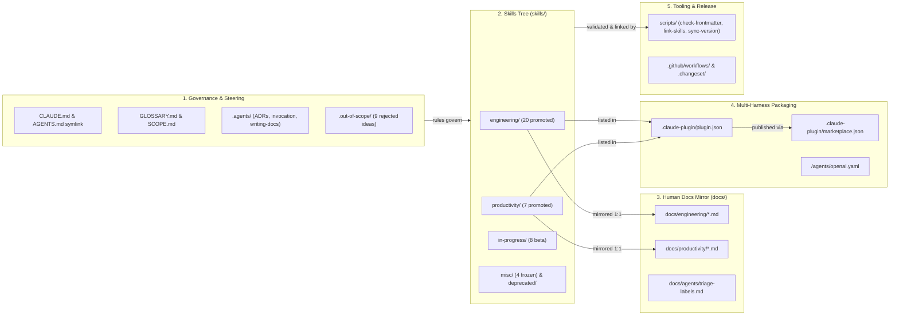
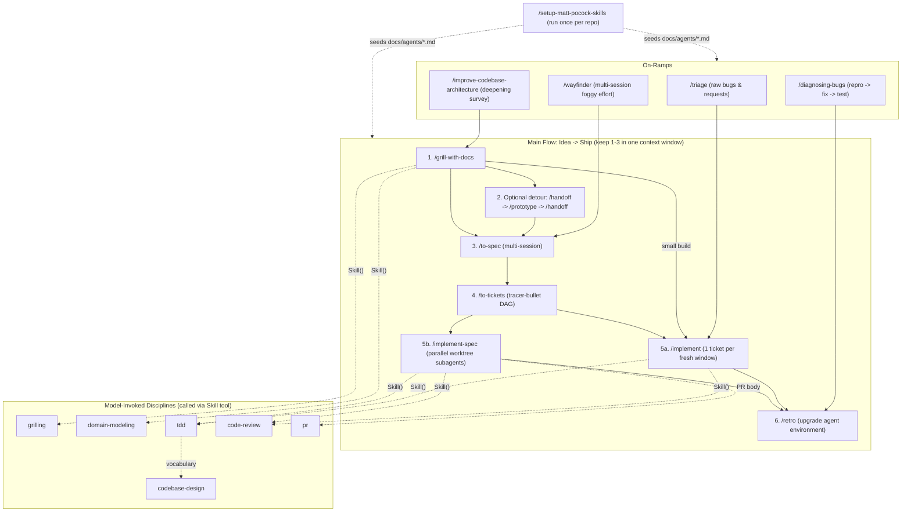
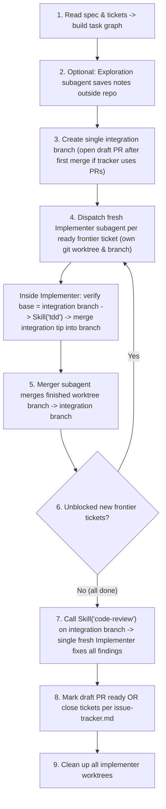

# How to Read `xavierxmorris/agents-skills`

A structured map for reading, adopting, and customizing this fork of Matt Pocock's **Skills for Real Engineers** (synced to upstream commit `6f7f783`).

---

## 1. The Mental Model in 60 Seconds

This repository looks big (~190 files), but **three design laws** explain almost every folder and convention in it:

1. **The Single-Axis Split (User-Invoked vs. Model-Invoked).**
   Every `SKILL.md` falls on one side of a strict boundary documented in [`.agents/invocation.md`](./.agents/invocation.md):
   - **User-invoked** skills are **orchestrators**. They set `disable-model-invocation: true` in `SKILL.md` *and* `policy.allow_implicit_invocation: false` in `agents/openai.yaml`. They cost **zero always-on context tokens**, can only be triggered when the human types `/skill-name`, and **no other skill can ever call them**.
   - **Model-invoked** skills are **reusable disciplines** (like `grilling`, `tdd`, `code-review`, `domain-modeling`). They stay discoverable by the model and are called by orchestrators via an explicit instruction: `Call the Skill tool with "<name>"` (never `../other-skill/FILE.md` links or bare `/name` prose).
2. **The Five-Bucket Lifecycle.**
   Skills under [`skills/`](./skills) live in five status buckets. Only **`engineering/`** and **`productivity/`** (27 skills total) are **promoted**, meaning they ship in `.claude-plugin/plugin.json`, appear in root `README.md`, get human docs under `docs/`, and are routed by `ask-matt`. Everything in `in-progress/`, `misc/`, and `deprecated/` stays out of the plugin and root `README.md`.
3. **Repo-as-Config via Pointer Injection.**
   The skills themselves stay generic and tracker-agnostic. Instead of hardcoding GitHub, GitLab, or Linear logic into every prompt, [`/setup-matt-pocock-skills`](./skills/engineering/setup-matt-pocock-skills/SKILL.md) injects a tiny `## Agent skills` pointer block into your project's `CLAUDE.md` or `AGENTS.md`, pointing at `docs/agents/*.md` adapter files.

> [!IMPORTANT]
> **Why `ask-matt` exists:** Because user-invoked skills cost zero context load, they shift the burden to *human memory* (you have to remember which slash command exists). [`ask-matt`](./skills/engineering/ask-matt/SKILL.md) is the **router skill** designed to cure that cognitive load: one command to remember that maps all the others.

---

## 2. Visual Repository Map

### Top-Level Directory Cheat Sheet

| Path | Primary Audience | What It Actually Does | Touch When Customizing Fork? |
| :--- | :--- | :--- | :--- |
| [`README.md`](./README.md) | Human | Philosophy ("4 failure modes"), multi-harness install commands, and catalog of the 27 promoted skills. | Yes, if adding or renaming promoted skills. |
| [`CLAUDE.md`](./CLAUDE.md) (`AGENTS.md` is a symlink to it) | Coding Agents | The **master rulebook** for maintaining this repo: bucket rules, plugin sync, docs sync, `ask-matt` sync, no em-dashes, fresh subagents. | **Read first.** Update if your fork diverges in policy. |
| [`GLOSSARY.md`](./GLOSSARY.md) | Human + Agent | Canonical vocabulary for this repo (`Issue tracker`, `Issue`, `Decision ticket`, `Triage role`) and avoided synonyms (`backlog`). | Only if you introduce new domain concepts. |
| [`SCOPE.md`](./SCOPE.md) & [`.out-of-scope/`](./.out-of-scope) | Maintainers | Upstream curation bar + 9 short decision memos on rejected ideas (e.g., native question tools, subagent recursion). | Great read to avoid anti-patterns; optional to keep. |
| [`.agents/`](./.agents) | Agents + Authors | Deep internal specs: `invocation.md`, `writing-docs.md`, `install-block.md`, and ADRs (`0001`, `0002`). | Reference constantly when authoring skills. |
| [`skills/`](./skills) | Harnesses + Agents | The actual skills. Every skill folder contains `SKILL.md`, `agents/openai.yaml`, and optional companion docs or scripts. | **Primary editing surface.** |
| [`docs/`](./docs) | Humans (aihero.dev) | Human-facing guides for the 27 promoted skills (always 4 sections: *What it does*, *When to reach for it*, *Common questions*, *It's working if*). | Sync if you want docs matching your fork's skills. |
| [`.claude-plugin/`](./.claude-plugin) | Claude, Copilot, Codex | `plugin.json` (promoted skill list + version) and `marketplace.json` (auto-update marketplace catalog). | **Yes.** Must add new promoted skills and update repo URLs for your fork. |
| [`scripts/`](./scripts) | Maintainers & CI | `check-frontmatter.mjs`, `link-skills.sh`, `list-skills.sh`, `sync-plugin-version.mjs`. | Run locally when editing; don't skip `check-frontmatter`. |

---

## 3. Exact Reading Order (4 Passes)

Do not read this repo alphabetically from `skills/engineering/ask-matt` down to `wizard`. Read it in **four layered passes**:

### Pass 1: The Operating System (~10 min)
1. [`README.md`](./README.md): absorb the 4 failure modes the skills solve (misalignment, verbosity, weak feedback loops, software entropy).
2. [`CLAUDE.md`](./CLAUDE.md): learn the exact invariants connecting buckets, `README.md`, `plugin.json`, `docs/`, and `ask-matt`.
3. [`.agents/invocation.md`](./.agents/invocation.md): the single most important technical doc in the repo (explains user- vs. model-invoked mechanics and `Skill` tool composition).
4. [`GLOSSARY.md`](./GLOSSARY.md): takes 90 seconds and prevents terminology confusion later.
5. [`skills/engineering/ask-matt/SKILL.md`](./skills/engineering/ask-matt/SKILL.md) + [`PHASE-BOUNDARIES.md`](./skills/engineering/ask-matt/PHASE-BOUNDARIES.md): the complete workflow map and context-window hygiene rules.

### Pass 2: The Delivery Spine (~15 min)
Read the core path from zero to merged code (dissected in Section 5 below):
1. [`skills/engineering/setup-matt-pocock-skills/SKILL.md`](./skills/engineering/setup-matt-pocock-skills/SKILL.md) + [`issue-tracker-github.md`](./skills/engineering/setup-matt-pocock-skills/issue-tracker-github.md) + [`domain.md`](./skills/engineering/setup-matt-pocock-skills/domain.md)
2. [`skills/engineering/grill-with-docs/SKILL.md`](./skills/engineering/grill-with-docs/SKILL.md) (notice it is only 247 bytes: a pure wrapper calling `grilling` and `domain-modeling`)
3. [`skills/engineering/to-spec/SKILL.md`](./skills/engineering/to-spec/SKILL.md) -> [`skills/engineering/to-tickets/SKILL.md`](./skills/engineering/to-tickets/SKILL.md)
4. [`skills/engineering/implement/SKILL.md`](./skills/engineering/implement/SKILL.md) vs. [`skills/engineering/implement-spec/SKILL.md`](./skills/engineering/implement-spec/SKILL.md)

### Pass 3: How to Write & Customize Skills Like This Repo (~15 min)
1. [`skills/productivity/writing-for-agents/SKILL.md`](./skills/productivity/writing-for-agents/SKILL.md) + [`SKILL-MECHANICS.md`](./skills/productivity/writing-for-agents/SKILL-MECHANICS.md): the meta-skill that codifies *how* every skill here is authored (progressive disclosure, context pointers, invocation trade-offs).
2. [`.agents/adr/0001-explicit-setup-pointer-only-for-hard-dependencies.md`](./.agents/adr/0001-explicit-setup-pointer-only-for-hard-dependencies.md) and [`0002-ship-as-a-claude-code-plugin.md`](./.agents/adr/0002-ship-as-a-claude-code-plugin.md).
3. Skim [`.out-of-scope/`](./.out-of-scope), especially `native-question-tool.md`, `subagent-recursion.md`, and `harness-name-collisions.md`.

### Pass 4: Packaging, Validation & Frontier (~10 min)
1. [`.claude-plugin/plugin.json`](./.claude-plugin/plugin.json) & [`.claude-plugin/marketplace.json`](./.claude-plugin/marketplace.json)
2. [`scripts/check-frontmatter.mjs`](./scripts/check-frontmatter.mjs) & [`scripts/link-skills.sh`](./scripts/link-skills.sh)
3. [`skills/in-progress/README.md`](./skills/in-progress/README.md): see where Matt is pushing multi-file skills next (`software-factory`, `chief-of-staff`).

---

## 4. The Skill Graph: How the Workflows Connect

### Promoted Skill Inventory (27 Skills)

| Bucket | User-Invoked (Orchestrators: type `/name`) | Model-Invoked (Disciplines: auto or `Skill()` called) |
| :--- | :--- | :--- |
| **`engineering/`** (20) | `ask-matt`, `setup-matt-pocock-skills`, `grill-with-docs`, `triage`, `improve-codebase-architecture`, `to-spec`, `to-tickets`, `implement`, `implement-spec`, `wayfinder`, `retro` | `prototype`, `diagnosing-bugs`, `research`, `tdd`, `domain-modeling`, `codebase-design`, `code-review`, `pr`, `wizard` |
| **`productivity/`** (7) | `grill-me`, `handoff`, `teach`, `to-questionnaire`, `wait-what` | `grilling`, `writing-for-agents` |

> [!TIP]
> **Context Hygiene Rule (`ask-matt`):** Keep `/grill-with-docs` -> `/to-spec` -> `/to-tickets` in **one unbroken context window** (up to the ~150k token "smart zone") so each artifact builds on the same primary-source thinking. Once tickets are published, **clear context**: every ticket is self-contained and gets its own fresh window (or fresh subagent).

---

## 5. Deep-Dive: The End-to-End Delivery Flow

Here is how to read the three skills that form the backbone of shipping real work in this repo, along with the subtle engineering patterns hidden inside each one.

### 5.1 `setup-matt-pocock-skills`: Repo Bootstrapping & Dependency Injection

**Files in [`skills/engineering/setup-matt-pocock-skills/`](./skills/engineering/setup-matt-pocock-skills):**
- `SKILL.md`: 5-step prompt-driven state machine (`Explore` -> `Present & Ask` -> `Confirm` -> `Write` -> `Done`)
- `agents/openai.yaml`: sets `allow_implicit_invocation: false` (paired with `disable-model-invocation: true`)
- **5 Seed Templates** copied into the target repo's `docs/agents/`:
  - `issue-tracker-github.md`, `issue-tracker-gitlab.md`, `issue-tracker-local.md`
  - `triage-labels.md`
  - `domain.md`

**What to notice when reading it:**
1. **Explore-first, skip-settled-questions design.** Before asking a single question, it inspects `git remote -v`, `CLAUDE.md`/`AGENTS.md`, `GLOSSARY.md` (and legacy `CONTEXT.md`), `docs/adr/`, `.scratch/`, monorepo files (`pnpm-workspace.yaml`, `workspaces`), and whether `triage` is installed. If `triage` isn't installed, it skips Section B entirely; if there's no monorepo, it silently picks single-context `GLOSSARY.md` without bothering the user.
2. **Adapter-pattern prompt files.** Open [`issue-tracker-github.md`](./skills/engineering/setup-matt-pocock-skills/issue-tracker-github.md): it doesn't just say "use GitHub." It defines an **interface contract** of exact CLI commands for abstract verbs used by downstream skills: *Create an issue*, *Make a sub-issue*, *Add a native blocking edge* (including the `gh` 2.94+ vs. older REST database-ID fallback), *Count open blockers*, and *Wayfinding operations*. Because the adapter lives in the target repo's `docs/agents/issue-tracker.md`, you can swap GitHub for Linear, Jira, or `.scratch/` markdown without changing a single line of `to-tickets` or `implement-spec`.
3. **Never create a competing steering file.** Step 4 enforces: if `CLAUDE.md` exists, edit it; else if `AGENTS.md` exists, edit it; only ask if neither exists. It injects only a compact `## Agent skills` pointer block, keeping root context tiny while pointing agents to `docs/agents/*.md` on demand.
4. **Hard vs. Soft Dependencies ([ADR 0001](./.agents/adr/0001-explicit-setup-pointer-only-for-hard-dependencies.md)).**
   - *Hard dependencies* (`to-spec`, `to-tickets`, `triage`, `implement-spec`) cannot function without tracker config, so their `SKILL.md` carries an explicit guard telling the user to run `/setup-matt-pocock-skills`.
   - *Soft dependencies* (`tdd`, `diagnosing-bugs`, `improve-codebase-architecture`) degrade gracefully if `GLOSSARY.md` / `docs/adr/` don't exist, and `domain.md` explicitly tells agents to **proceed silently** if domain docs are missing (they are created lazily by `domain-modeling`).

> [!WARNING]
> **Fork Gotcha Already Handled Inside `issue-tracker-github.md`:** In a GitHub fork, `gh` sometimes defaults to the upstream parent repo (`mattpocock/skills`). The template explicitly instructs agents to run `gh repo view --json nameWithOwner` before the first `gh issue create` and verify it's your repo: a great pattern to preserve when customizing.

---

### 5.2 `to-tickets`: Tracker Abstraction & Graph Construction

**File:** [`skills/engineering/to-tickets/SKILL.md`](./skills/engineering/to-tickets/SKILL.md)

**What to notice when reading it:**
1. **User-invoked precondition wording.** Line 11 says: *"The issue tracker and triage label vocabulary should have been provided to you. If not, tell the user to run `/setup-matt-pocock-skills`."* Notice it does **not** say `Call the Skill tool with "setup-matt-pocock-skills"`, because `setup-matt-pocock-skills` is user-invoked and unreachable by any agent.
2. **Structured prompt constraints (`<vertical-slice-rules>`).** Notice the XML-tag block enforcing **tracer bullets**: every ticket cuts vertically across schema, API, UI, and tests, is independently verifiable, and is sized to fit inside **one fresh context window**.
3. **Explicit escape hatch for wide refactors.** Instead of pretending every task is a vertical slice, Step 3 carves out a crisp **expand -> migrate in blast-radius batches -> contract** pattern so mechanical cross-codebase renames keep CI green ticket-to-ticket.
4. **Mandatory human alignment gate (Step 4).** It never writes straight to your tracker; it quizzes you on granularity and blocking edges first.
5. **Dual-target publishing driven by the adapter (Step 5).**
   - *Local tracker*: writes `.scratch/<feature-slug>/issues/<NN>-<slug>.md` (strictly one file per ticket, numbered blockers-first, using `<local-ticket-template>`).
   - *Real tracker (GitHub, GitLab, Linear)*: publishes **blockers first** so downstream tickets can reference real issue IDs as native blocking edges, links them as sub-issues of the parent spec, and applies `ready-for-agent` (which is why `ask-matt` says *never run `/triage` on `/to-tickets` output*).
6. **Anti-staleness rule.** Tickets forbid brittle file paths and raw code snippets, except decision-rich prototype extracts (state machines, reducers, schemas) trimmed down to the exact decision.

---

### 5.3 `implement-spec`: Subagent Orchestration & Worktree DAG

**File:** [`skills/engineering/implement-spec/SKILL.md`](./skills/engineering/implement-spec/SKILL.md)

At only ~2.8 KB, `implement-spec` is a masterclass in dense agent orchestration. Instead of executing tickets sequentially like `/implement`, it treats tickets as a **DAG (Directed Acyclic Graph)** and maximizes parallel throughput across isolated git worktrees:

**Three subtle mechanics to look for when reading or adapting it:**
1. **Fresh-context mandate.** *"Start every subagent with a fresh context window."* As `CLAUDE.md` explains, some harnesses (like Codex) fork the parent conversation by default, which silently defeats context isolation. Always keep this explicit sentence in any orchestrator skill you write.
2. **Sparse context-pointer communication.** The coordinator never pastes the spec or codebase into subagent prompts. It passes *pointers* (spec link, ticket ID, outside-repo exploration notes path, commit hashes). That keeps every implementer inside the smart zone.
3. **Clean role separation + `Skill` tool composition.** Notice four distinct roles: *Exploration* (reads once, writes shared notes outside the repo so working trees stay clean), *Implementer* (1 fresh subagent per ticket, invokes model-invoked `tdd`), *Merger* (serializes merges onto the integration branch to avoid race conditions), and *Reviewer* (invokes model-invoked `code-review`, whose findings are fixed by one final fresh implementer).

---

## 6. Multi-Harness Packaging & Customization Playbook

To keep this fork portable across **GitHub Copilot**, **Claude Code**, **Codex**, and **Gemini CLI / Antigravity**, here is how the repo's packaging files map to each harness:

| Harness | Discovery / Install Mechanism | How User-Only Invocation Is Enforced | Auto-Updates? |
| :--- | :--- | :--- | :--- |
| **GitHub Copilot (CLI & VS Code)** | Reads `.claude-plugin/marketplace.json` + `.claude-plugin/plugin.json` (`copilot plugin marketplace add` / VS Code *Chat: Install Plugin From Source*) | Reads `disable-model-invocation: true` in `SKILL.md` frontmatter | Yes (daily in VS Code; `autoUpdate: true` in `~/.copilot/settings.json`) |
| **Claude Code** | Reads `.claude-plugin/plugin.json` (`claude plugin install`) or local symlinks in `~/.claude/skills` | Reads `disable-model-invocation: true` in `SKILL.md` frontmatter | Yes (via marketplace) or `git pull` (via symlinks) |
| **Codex** | Reads `.claude-plugin/marketplace.json` + `plugin.json` (`codex plugin marketplace add`), plus `agents/openai.yaml` per skill; or symlinks in `~/.agents/skills` | Reads `policy.allow_implicit_invocation: false` in `agents/openai.yaml` | Yes (at startup) or `git pull` (via symlinks) |
| **Gemini CLI / Antigravity** | `gemini skills install <repo-url> --path skills/engineering` (and `productivity`) or local symlinks in `~/.agents/skills` | Reads `SKILL.md` frontmatter + directory discovery | Manual re-run or `git pull` (via symlinks) |
| **Any other agent (`skills.sh`)** | `npx skills@latest add <owner>/<repo>` copies editable files | Reads `SKILL.md` frontmatter (validated by `scripts/check-frontmatter.mjs` using the `yaml` package) | Manual (`npx skills@latest update`) |

### Crucial Fork Step: Pointing the Manifests at `xavierxmorris/agents-skills`

Right now, this fork is an unmodified mirror of upstream, so [`.claude-plugin/plugin.json`](./.claude-plugin/plugin.json) and [`.claude-plugin/marketplace.json`](./.claude-plugin/marketplace.json) still declare `"name": "mattpocock-skills"` and `"repository": "https://github.com/mattpocock/skills"`.

- **If you want Copilot, Codex, or Claude Code to install and auto-update from this fork:**
  1. Keep `source: "./"` in `.claude-plugin/marketplace.json`, update `name`/`owner`/`repository` if you want a distinct namespace (so it doesn't collide with upstream `mattpocock-skills`), and point your marketplace config to `xavierxmorris/agents-skills`.
  2. Be aware that editing `plugin.json`, `marketplace.json`, or `README.md` creates small merge conflicts when syncing with upstream `mattpocock/skills`. Keeping your custom skills in distinct folders (or a dedicated custom bucket) makes upstream rebases painless.

### Customization Checklists

#### A. Editing an Existing Skill
1. Edit `skills/<bucket>/<name>/SKILL.md` (and any companion `*.md` or scripts).
2. If you change whether it's user-invoked vs. model-invoked, update **both** `disable-model-invocation: true` in `SKILL.md` **and** `policy.allow_implicit_invocation: false` in `agents/openai.yaml` (never let them drift).
3. Run `npm run check-frontmatter` (`scripts/check-frontmatter.mjs` catches unquoted `: ` colons in YAML descriptions that silently break `skills.sh` installs).
4. If you care about keeping docs and the router in sync: update `docs/<bucket>/<name>.md` and `skills/engineering/ask-matt/SKILL.md`.

#### B. Adding a New Promoted Skill to Your Fork
1. Create `skills/<bucket>/<new-skill>/SKILL.md` + `agents/openai.yaml`.
2. Add `"./skills/<bucket>/<new-skill>"` to `.claude-plugin/plugin.json`'s `skills` array.
3. Add an entry to root `README.md` and `skills/<bucket>/README.md` (under **User-invoked** or **Model-invoked**).
4. Add its routing entry to `skills/engineering/ask-matt/SKILL.md` (if user-reachable).
5. Optionally add `docs/<bucket>/<new-skill>.md` using the 4-section template in [`.agents/writing-docs.md`](./.agents/writing-docs.md).
6. Validate with `npm run check-frontmatter` (and `claude plugin validate . --strict` if you have Claude CLI installed).

#### C. Fast Local Dev Loop Across Harnesses
[`scripts/link-skills.sh`](./scripts/link-skills.sh) symlinks every skill **except `misc/` and `deprecated/`** (meaning **`in-progress/` IS linked**) into both `~/.claude/skills` and `~/.agents/skills`.

> [!NOTE]
> On Windows, `scripts/link-skills.sh` is a bash script using `ln -sfn`. If you run it via Git Bash without Developer Mode or symlink privileges, Windows may copy or fail on symlinks: either enable Windows Developer Mode (so `ln -s` creates real symlinks) or use a small PowerShell junction script (`New-Item -ItemType Junction`) mirroring `link-skills.sh`'s exact filter (`engineering/`, `productivity/`, `in-progress/`).

---

## 7. Quick Tour of `skills/in-progress/` & What to Ignore

### Experimental Bucket: [`skills/in-progress/`](./skills/in-progress) (8 Beta Skills)
Not in `plugin.json` yet, no `docs/` pages, subject to change, and great for seeing the repo's newest structural patterns:

| Theme | Skills | What's Interesting to Study |
| :--- | :--- | :--- |
| **Autonomous & Multi-Session Orchestration** | `software-factory`, `chief-of-staff`, `loop-me`, `claude-handoff` | Look at [`software-factory/`](./skills/in-progress/software-factory): 6 modular reference files (`RUNNERS.md`, `GIT-HOSTS.md`, `TICKET-TRACKERS.md`, `OBSERVABILITY-PLATFORMS.md`, `EXAMPLE-TASKS.md`) showing progressive disclosure for large domain vocabularies. `chief-of-staff` demonstrates delegating to fresh subagents and persisting institutional memory in a dated wiki. |
| **Automated Architecture Guardrails** | `setup-ts-deep-modules` | Ships a real config artifact (`dependency-cruiser.config.cjs`) alongside `SKILL.md` to enforce deep-module boundaries mechanically in TypeScript repos. |
| **Long-Form Writing Pipeline** | `writing-beats`, `writing-fragments`, `writing-shape` | Shows how the `grilling` pattern adapts to non-engineering creative workflows (mining raw fragments, shaping prose, pacing beats). |

### What You Can Safely Ignore (At First)
- **`skills/misc/`** (4 frozen skills like `git-guardrails-claude-code`, `setup-pre-commit`) and **`skills/deprecated/`**: unmaintained, excluded from plugins and symlinks.
- **`CHANGELOG.md` & `.changeset/`**: only needed if you cut versioned plugin releases (`npm run version` runs `changeset version && node scripts/sync-plugin-version.mjs`).
- **Don't ignore [`.out-of-scope/`](./.out-of-scope).** Even though it looks like bureaucracy, its 9 one-page memos explain *why* the repo avoids things like hard question limits (`question-limits.md`), subagent-spawning-subagents (`subagent-recursion.md`), and coupling to harness-specific question tools (`native-question-tool.md`). Reading those saves you from reinventing known failure modes when customizing your fork.
